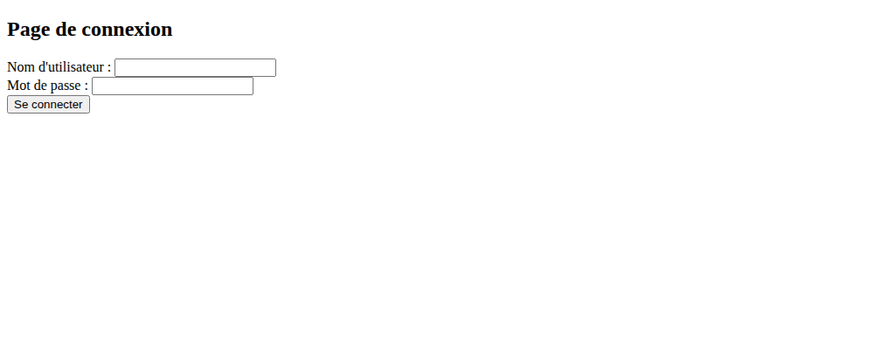
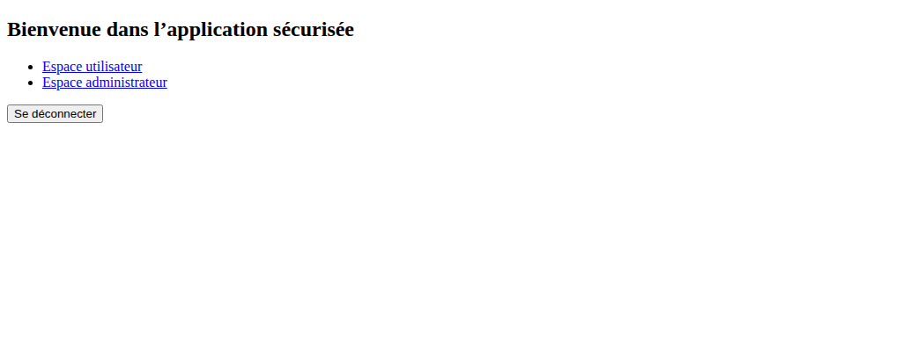
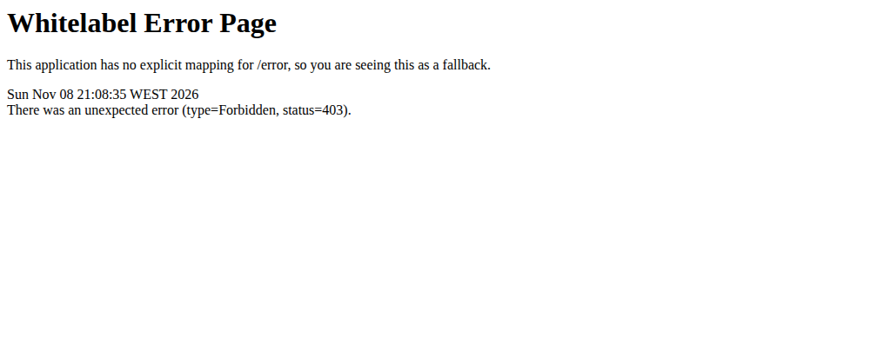
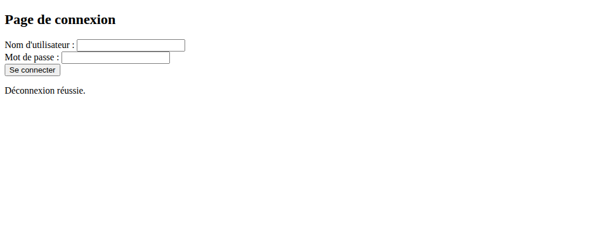
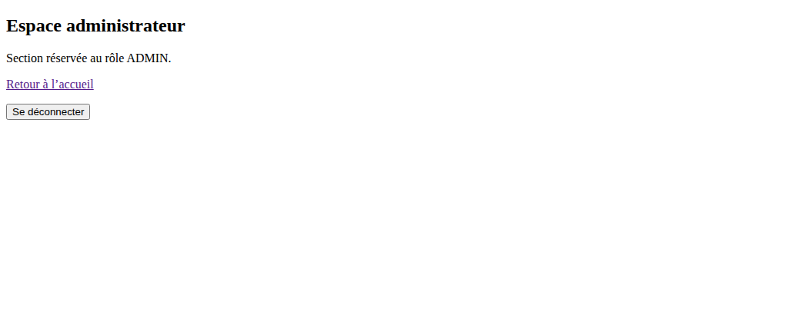
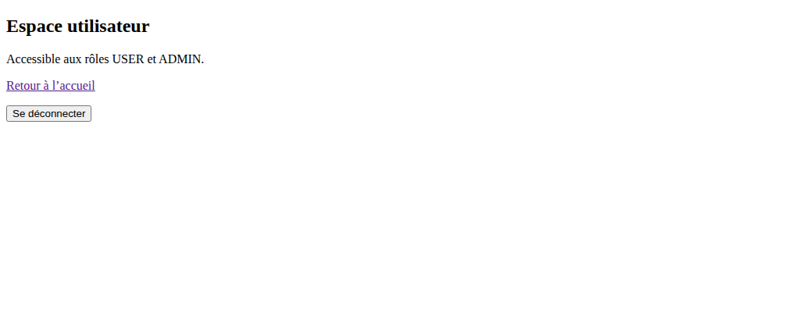

# TP11 — Authentification JDBC / JPA

Spring Security charge les utilisateurs et leurs rôles depuis MySQL avec Spring Data JPA. `CustomUserDetailsService` fournit ces informations à Spring Security et BCrypt vérifie le mot de passe.

## Lancement

1. Démarrer MySQL et créer la base `security_db` avec l’encodage `utf8mb4`.
2. Vérifier les paramètres MySQL locaux dans `src/main/resources/application.properties`.
3. Lancer `mvn spring-boot:run` ou la classe `SpringSecurityJpaApplication` dans IntelliJ, puis ouvrir [la page de connexion](http://localhost:8080/login).

## Connexion et accès utilisateur

Le formulaire permet de se connecter avec les comptes de démonstration créés au démarrage.

Un mot de passe incorrect affiche un message d’erreur.

Le compte `user` arrive sur l’accueil et peut ouvrir l’espace utilisateur.

L’accès de `user` à `/admin/dashboard` est refusé avec le statut HTTP 403.

Le bouton **Se déconnecter** ferme la session et ramène à la page de connexion.

## Accès administrateur

Le compte `admin` peut ouvrir l’espace administrateur et l’espace utilisateur.

## Vérifications MySQL

Les essais ont été réalisés avec MySQL 8.0.46. Les tables `user`, `role` et `user_roles` ont été créées. Les deux comptes sont actifs et leurs mots de passe sont stockés sous forme de hachages BCrypt de 60 caractères avec le préfixe `$2a$`. Le test Maven de démarrage du contexte a réussi.
